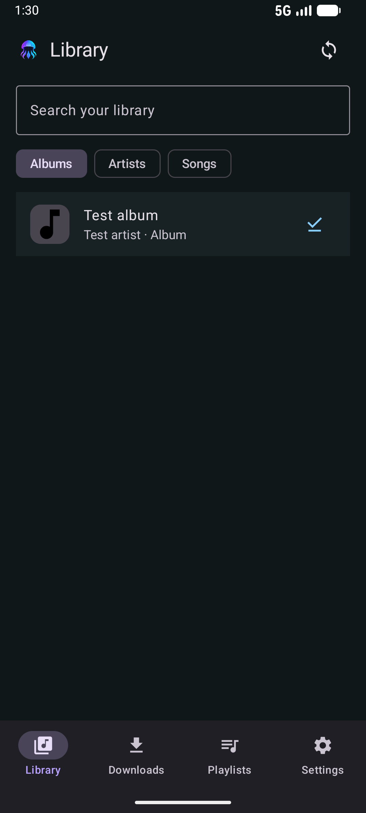
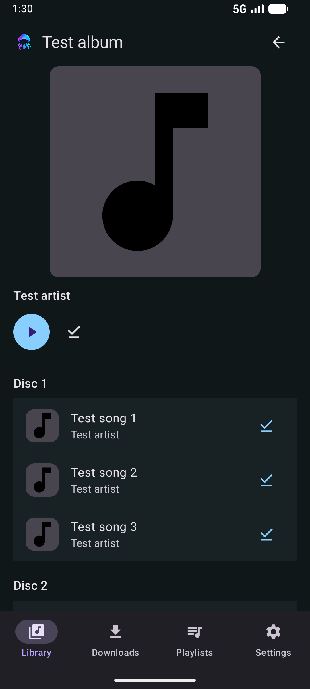
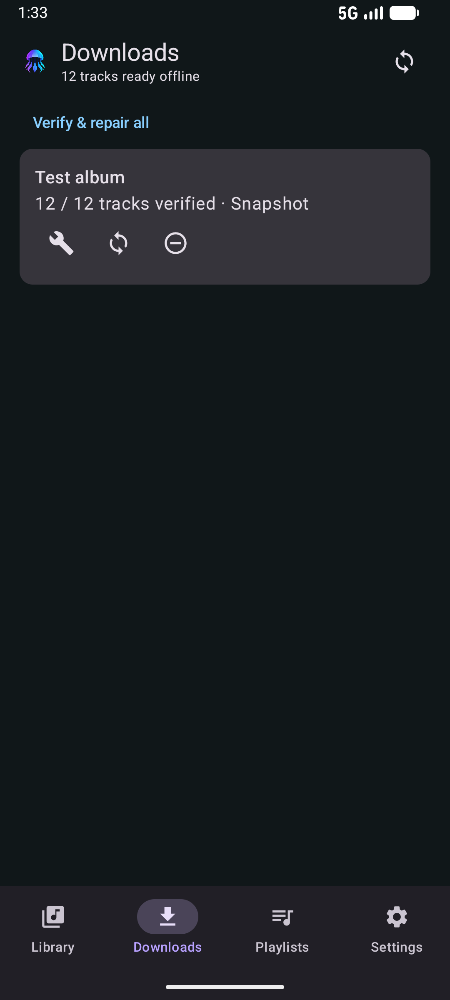
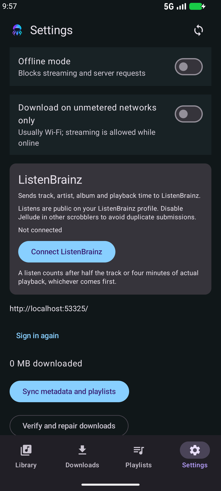

# Jellude


An Android music player for your Jellyfin server, focused on a verifiable offline library: download collections, see what is missing, and repair incomplete or damaged local copies.

**Experimental · Source-only distribution · Android 10+**

Jellude is an independent project, unaffiliated with Jellyfin. It is under active development and has not been independently audited. Public availability is not a production-readiness claim. Official signed APK releases are planned for later; [build from source](#build-from-source) for now.

## AI development disclosure

Jellude's own application code was written entirely using AI coding tools, under human direction. The project owner defines the requirements, tests the app, and approves changes and releases. Third-party libraries retain their respective authorship and licenses. Human-written contributions are welcome.

AI-generated code can contain bugs, security issues, and incorrect assumptions. Passing tests and successful personal use do not establish production readiness or constitute an independent audit. Review the known limitations and report problems through GitHub Issues. Never include passwords, access tokens, or private server details in public reports.

## Features

- Stream from Jellyfin or play verified downloads while offline.
- Download songs, albums, album artists, and playlists; keep a snapshot or synchronize collection membership.
- See partial/complete download states and expected/verified track counts; verify and repair missing or corrupt downloads.
- Synchronize server metadata, artwork, and lyrics without unnecessarily replacing audio.
- Read lyrics, including timestamped lyrics when supplied by the server.
- View the playing queue, see the next track, jump/remove/clear tracks, shuffle, or repeat the queue or one song.
- Create server playlists and queue entry additions/removals/reordering or renaming, with conflict/uncertain-outcome handling.
- Browse the media library through Android Auto. Full car/head-unit validation remains outstanding.
- Optionally submit listening history directly to ListenBrainz, including offline listens and custom recordings without MusicBrainz IDs.

Jellude cannot delete music files from your Jellyfin server. It does not offer whole-playlist deletion. Download cleanup affects local files only; removing a playlist entry changes membership only.

<p>
  
  
  
</p>

The Library, album and Downloads screenshots show the compact layout verified on an Android 17 (API 37) emulator. Test albums use placeholder artwork.

## Build from source

1. Clone [cdalamagkas/Jellude](https://github.com/cdalamagkas/Jellude) and open the repository root in Android Studio.
2. Use **Gradle JVM/JDK 21**, Android SDK **platform 37**, and **Build Tools 36.0.0**. Let Android Studio create the machine-local SDK configuration.
3. Sync Gradle and run the `app` configuration, or build from a terminal:

```sh
./gradlew :core:test :app:assembleDebug :app:lintDebug
```

On Windows PowerShell use `.\gradlew.bat` instead of `./gradlew`. The development APK is written to `app/build/outputs/apk/debug/app-debug.apk`; install it on your device. It is signed with your machine's debug key and may not update a build signed on another computer. Debug builds and CI reports are development tools, not official production releases.

The project uses AGP 9.4.1, Gradle 9.8.1, Kotlin 2.4.21 and KSP 2.3.12. Compile SDK is 37; target SDK remains 35 and minimum SDK is 29. The application ID is `dev.jellude`.

## Connect and keep music offline

1. Enter your Jellyfin URL (including any reverse-proxy base path), username and password. Prefer HTTPS and an account with only the download/playlist permissions you need. Wait for catalogue synchronization.
2. Browse or search Albums, Artists (album artists), Songs, or Playlists. Tap a download icon and choose a snapshot or synchronized collection. Playlists default to synchronized membership.
3. A downloading symbol means partial, pending, or needing attention; a download check mark means complete according to the local catalogue/verified asset records. Tap the action or open Downloads to inspect it. A failed discovery is never shown as complete.
4. In Downloads, **Verify & repair all** checks local files and requeues missing or damaged tracks. Each item's wrench icon repairs its files, the circular arrows refresh its track list, and the minus-in-a-circle icon stops keeping it offline. Long-press an action icon for its label. Metadata/playlist synchronization is also available in Settings.
5. Enable **Offline mode** to block the app's server requests. Downloads default to unmetered networks. Original audio playback depends on your device's codec support.

**Stop keeping offline** stops automatic retention/repair for that selection but leaves existing local copies visible in Downloads as a local, unsynchronized copy. Use **Keep offline again** to resume retention. **Settings → Clean up unused local downloads** removes only audio no remaining offline selection needs. Tracks shared by another downloaded song/album/artist/playlist are preserved. Uninstalling or clearing the app's storage removes app-managed downloads. Offline browsing shows downloaded tracks and collections containing downloaded tracks; unavailable tracks are hidden inside collections too.

A **Snapshot** keeps the track list saved when you downloaded the item; **Refresh tracks** updates it manually. **Synchronized** collections also refresh their membership during library synchronization.

Tap the bottom player's artwork or title to expand it. Both player sizes have a draggable seek bar. The expanded player shows cover art, elapsed/total/remaining time, and encoding details when supplied by Jellyfin. Its lyrics button lights up when lyrics are available and switches the cover to lyrics; timestamped lyrics follow playback. The queue icon opens the playing queue. Collection pages show cover art, and multi-disc albums have disc headings. Repeat cycles **off → queue → song → off**. Clearing the queue does not remove playlists or downloads and stays cleared after the playback service restarts.

## Optional ListenBrainz submission

Open **Settings → ListenBrainz → Connect ListenBrainz**, get your user token from [ListenBrainz settings](https://listenbrainz.org/settings/), and choose **Connect and enable**. This feature is off by default and does not require the ListenBrainz Android app. Disable Jellude in other scrobblers when using direct submission to avoid duplicate listens.



Jellude counts actual playing time, excluding pauses and buffering. A listen qualifies after half the track or four minutes, whichever comes first; seeking ahead does not add time. Repeating a track creates a new listen. Enabling or resuming submission begins tracking from that point; previously untracked plays are not imported. Qualified listens are queued in a separate local database, survive app restarts, and upload on a connected network with their original playback timestamps. Offline mode blocks uploads while continuing to collect listens during offline playback. Uploads can use mobile data; the unmetered-only setting applies to music downloads.

The Settings panel shows queued listens, errors, and upload status, with **Retry uploads** and **Clear queue** controls. Invalid tokens require reconnecting. Temporary connection/server errors retry in the background, subject to Android scheduling. Turning submission off stops tracking and uploading but keeps the queue. **Disconnect** forgets the token and deletes queued listens; it does not delete anything already uploaded to ListenBrainz. You must disconnect before changing ListenBrainz accounts.

Artist, title and album come directly from Jellyfin metadata. Custom recordings and covers are accepted without MusicBrainz IDs; Jellude does not guess IDs or split filenames to infer an artist. Missing artist/title metadata is flagged for attention. ListenBrainz may independently match submitted metadata to MusicBrainz. Only metadata is uploaded, never audio or your Jellyfin address; your listening history may be public on ListenBrainz. See [privacy](PRIVACY.md).

Only qualified listens are persisted; partial listening time is not recovered after process termination. Retries reuse the original timestamp and metadata, but exactly-once delivery cannot be guaranteed if a response is lost after the server accepts a submission. Live “playing now” updates are not sent.

## Compatibility and current limits

The owner reports successful use of development version 0.1.3 on a **POCO F7 Ultra with Android 16 and Jellyfin Server 12.2**. Automated mock-server integration tests have run on Android 15, 16 and 17 emulators. The latest regression run passed 25 core tests and all 19 integration tests on Android 17 (API 37), including offline ListenBrainz queuing/upload, album spacing, and Downloads action alignment. ListenBrainz tests use mock endpoints; live-account and physical-device validation of this feature remain outstanding. These results do not establish compatibility with every server, device, format, or proxy. See [compatibility evidence](docs/COMPATIBILITY.md) and [test results](docs/TEST_RESULTS.md).

- Long background downloads still depend on Android job quotas and manufacturer battery restrictions. Large-library, reboot, low-space and extended-offline reliability need more physical-device testing.
- Real Android Auto driving UI, voice control and reconnection need car/head-unit validation.
- Original-format downloads only; no transcoded downloads or conversion.
- One outstanding edit per playlist; no automatic three-way merge or offline playlist creation. Concurrent server edits can still race a mutation.
- Account switching/sign-out with local-retention controls is unfinished. No broad multi-account support is claimed.
- Room schema updates use explicit migrations to preserve existing library and download records.

See the [roadmap](docs/ROADMAP.md), [architecture](docs/ARCHITECTURE.md), and [release policy](docs/RELEASING.md).

## Contributing, privacy and security

- [Contributing](CONTRIBUTING.md): setup, tests, PR expectations and AI-assistance disclosure.
- [Report a bug or request a feature](https://github.com/cdalamagkas/Jellude/issues/new/choose). Use test data and redact sensitive information.
- [Security policy](SECURITY.md): report vulnerabilities privately; do not disclose exploits in public issues.
- [Privacy](PRIVACY.md): connections, credentials, local storage, permissions and cleanup.
- [Changelog](CHANGELOG.md) and [GitHub workflow](docs/GITHUB_WORKFLOW.md).

## License and attribution

Jellude's own code and artwork are offered under **GNU GPL version 3 only (`GPL-3.0-only`)**, to the extent licensable rights apply. See [LICENSE](LICENSE) and [NOTICE](NOTICE). Third-party components retain their own licenses; see [third-party notices](THIRD_PARTY_NOTICES.md). Separate [branding guidance](docs/branding/README.md) requires modified distributions to use a distinct identity and avoid implying maintainer endorsement, without restricting GPL copyright permissions.
